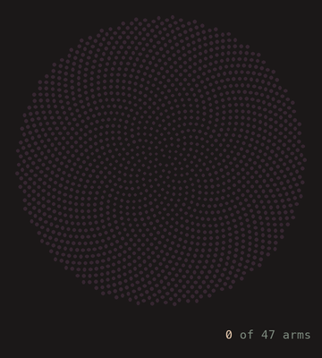

# Eggplant — VS Code Theme

Deep and quiet, like a dark kitchen at dusk. Near-black ink backgrounds and aubergine shadows keep the screen calm, while peach text and sage comments stay easy on the eyes. Plum selections glow just enough to find your place.


## Forty-Seven Arms



Most sunflowers grow their seeds in Fibonacci spirals. A few follow the Lucas sequence instead (2, 1, 3, 4, 7, 11, 18, 29, 47), turning each seed 99.50° past the last, and show 47 spiral arms. 47 is also a safe prime: 47 = 2 × 23 + 1, and 23 is prime. [`examples/sunflower.py`](examples/sunflower.py) works this out, and [`examples/count_arms.py`](examples/count_arms.py) draws the same animation in VS Code's terminal using the theme's ANSI colors.

## Install

Search for **Eggplant** in the Extensions view, or run:

```bash
code --install-extension CKinkadeDarling.eggplant
```

Then press `Cmd+K Cmd+T` (`Ctrl+K Ctrl+T` on Windows/Linux) and pick **Eggplant**.

## Palette

Inspired by [My puppeteer Color Palette](https://www.color-hex.com/color-palette/1085864)

| Swatch | Hex | Role |
| --- | --- | --- |
|  | `#1b1818` | Editor, sidebar and panel background (ink) |
|  | `#362631` | Current line, word highlights, indent guides (aubergine) |
|  | `#e9caae` | Foreground text, variables (peach) |
|  | `#584b6d` | Selection, button hover (plum) |
|  | `#7d8a7e` | Comments, active borders, badges, muted UI (sage grey, lightened from the source for contrast) |
|  | `#525d53` | Source palette (sage grey) |

## Derived Syntax Colors

| Swatch | Color | Hex | Used for |
| --- | --- | --- | --- |
|  | Sage | `#9fb48a` | Strings, docstrings |
|  | Orchid | `#b89ac8` | Keywords, control flow, `global` / `nonlocal`, exceptions, CSS at-rules |
|  | Pale blue | `#8db1cc` | Functions, HTML tags, links |
|  | Teal sage | `#7fb0a6` | Builtins, builtin types (`int`, `str`, `list`), type hints, `__name__`, CSS properties |
|  | Gold | `#d6ae78` | Classes, headings, HTML attribute values |
|  | Terracotta | `#c98f7a` | Decorators, f-string braces, escape sequences, HTML attributes |
|  | Pink | `#c48aa8` | Numbers, enum members, CSS colors and units |
|  | Bronze | `#b88a5e` | `True` / `False` / `None`, `ALL_CAPS` constants, read-only values |
|  | Lavender grey | `#9c8ab4` | `self` / `cls`, CSS pseudo-classes |
|  | Steel | `#96a4b8` | CSS / SCSS variables |

## Git Colors

| Swatch | Hex | Used for |
| --- | --- | --- |
|  | `#7a9a7a` | Added / untracked |
|  | `#96a4b8` | Modified |
|  | `#b06a78` | Deleted |
|  | `#a07fa8` | Conflicts |
